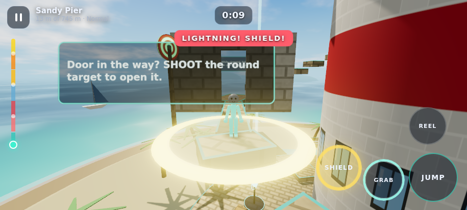
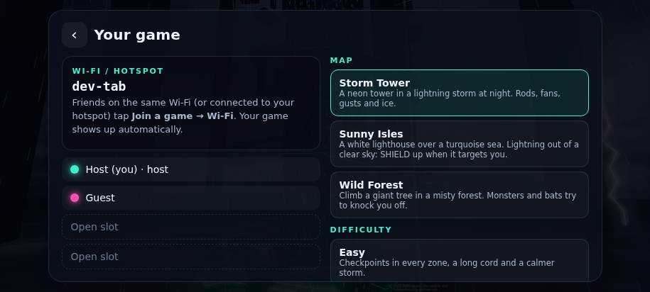

# StickManUp


A co-op climbing game for Android. Up to four stickmen are tied together by a glowing cord and climb a giant tower
on one of three maps. If one falls, the cord drags everyone with it.

**[Download the latest APK](../../releases/latest)** · Android 8.0+ · no root needed · about 450 KB


| | |
|---|---|
|  |  |
|  |  |
|  |  |

## Three maps

Each map is a 745 m climb in seven zones with 800 to 950 platforms, and each one climbs its own way:

- **Storm Tower**: round and round a neon tower in a lightning storm at night. Lightning hunts you: when a yellow
  ring appears under you, tap **SHIELD**. Lightning rods glow before they strike, laser bars spin across platforms
  (jump them), laser gates switch on and off across bridges, fans and gusts blow you off walkways and the ice near the
  top is slippery.
- **Sunny Isles**: back and forth across a white lighthouse in two lanes, hopping over at each turn. Arrow traps fire
  across the bridges and platforms swing like pendulums.
- **Wild Forest**: round a giant tree the other way, with branch walks out to smaller trees that you climb around
  before coming back. Monsters patrol wide ledges, bats circle the gaps and arrow traps hide in the branches.

Every map has special areas:
- **Hooks** over gaps too wide to jump: tap **GRAPPLE** to zip up and get thrown across.
- **Doors** blocking bridges: hold **SHOOT** to aim over your shoulder, drag to put the crosshair on the round
  target and let go to fire. It opens the door for the whole team. There's no auto-aim: you have to actually hit it.
  In the forest, shooting also stuns monsters and bats for a few seconds.

**Difficulties**
- **Easy**: a checkpoint in every zone, a long cord and calmer hazards
- **Normal**: three checkpoints on the whole climb
- **Hardcore**: no checkpoints and a shorter cord. Fall all the way down and the team starts over.

The climb saves itself. Solo players can continue from the title screen, and a multiplayer host can continue the
saved climb from the lobby.

## Moves

| Control | What it does |
|---|---|
| Left side of the screen | Floating stick to move |
| Right side of the screen | Drag to look around |
| **JUMP** | Tap for a hop, hold for full height |
| **GRAB** (hold) | Clamp onto anything you touch, even walls. Grip drains faster on walls. |
| **REEL** (hold) | Pull the cord in. It turns into **PULL** when your partner hangs below you (hauls them up and over the edge) and **CLIMB** when you're the one hanging |
| **GRAB + REEL, release REEL** | Sling your partner upward |
| **GRAPPLE** | Shows up near a hook: zip up and get thrown across |
| **SHOOT** (hold, drag, release) | Aim with the crosshair, fire on release |
| **SHIELD** | Storm Tower: blocks lightning and hits for a second |

If your partner falls, their weight drags you toward the edge. Hold GRAB to stop them, or walk away from the edge to
haul them up. Keyboard (WASD, Space, Shift, E, F grapple, R hold to aim, Q) and game controllers work too.

Settings let you resize the buttons, change their opacity, put them on the left side, or drag each one wherever
you like. Tips show up once as see-through cards; after that, tap the small **!** markers to read them again.

## Smooth on any phone

On Android the 3D world is drawn by the app's own OpenGL ES 3.0 renderer, not by WebGL in the WebView. The game sends
only what changed each frame, and the renderer lowers its resolution by itself when a phone can't keep up and raises
it again when there is headroom, so the game stays at a steady 60 fps.

Graphics settings: resolution, sharpness, smooth edges (anti-aliasing), glow strength, 30/60/120 fps, and automatic
resolution on or off. Automatic resolution works inside the renderer (the scene is drawn smaller and scaled up in the
final pass), so the screen surface never resizes mid-game.

The soundtrack is generated live: an original electro/techno track with its own style per map, building in sections
and getting busier the higher you climb.

## Multiplayer

Up to 4 climbers. Everyone needs the same StickManUp version. The host picks the map.

- **Online**: the host gets a 5-letter room code and friends type it in. The phones connect directly over WebRTC; the
  free [PeerJS](https://peerjs.com) server only introduces them. Some networks (often mobile data) don't allow a
  direct WebRTC connection, and there are no free relay servers left, so use Internet (direct) then.
- **Internet (direct)**: no server at all. The host's phone asks its router to open the game port (UPnP), finds its
  public address with a STUN lookup and shows a 10-character code; friends anywhere type it in and connect straight
  to the host. Host from a home Wi-Fi (mobile data uses carrier NAT, which nobody can open; the lobby says so).
- **Wi‑Fi / hotspot**: games on the same network show up automatically. No internet needed, so one phone can run a
  hotspot for the others.
- **Bluetooth**: for when there is no Wi‑Fi at all. Pair the phones once in Android settings, then join from the list.

Friends can join a climb that is already running.

## Build from source

No Gradle or Android Studio needed. On Debian/Ubuntu (works on arm64, including inside Termux proot):

```sh
sudo apt install openjdk-21-jdk-headless aapt apksigner zipalign android-sdk-platform-23 dalvik-exchange
./build.sh   # → build/StickManUp.apk
```

`build.sh` creates a local signing key (`stickmanup.jks`) on first run. The key is not in this repo. Keep your own copy,
because Android only installs updates signed with the same key.

To play or debug in a desktop browser, serve `assets/` with any static server (for example
`python3 -m http.server -d assets`). Two tabs in the same browser can play Wi‑Fi multiplayer against each other.

## How it works

- `assets/js/`: the whole game in plain JavaScript modules on top of [three.js](https://threejs.org)
  - `level.js`: generates the identical maps on every phone from fixed seeds
  - `physics.js`, `player.js`, `chain.js`: collision, movement, abilities and the cord (a bead chain drapes it over
    ledges; it only pulls when stretched, so it never snags)
  - `storm.js`: lightning, fans, gusts, monsters and bats, all timed from shared game time so every phone agrees
  - `net.js`, `game.js`: host-relayed multiplayer; each phone simulates its own climber and applies its share of the
    cord pull, so the game stays responsive over a laggy connection
  - `render.js`, `worldview.js`, `stickman.js`: sky, sun, ocean, weather, the instanced maps and the animated stickmen
  - `mirror.js`: streams the scene to the native renderer
- `src/`: a small Java activity that runs the game in a full-screen WebView, the native OpenGL ES renderer
  (`src/io/stickmanup/gl/`), and Wi‑Fi (TCP plus UDP discovery) and Bluetooth (RFCOMM) sockets for the game
- `dev/`: node tests for the levels, physics and networked cord, Playwright scripts that drive the game in headless
  Chromium, and a desktop (JOGL) harness that replays a recorded frame through the native renderer

Uses three.js and PeerJS, both MIT licensed.
