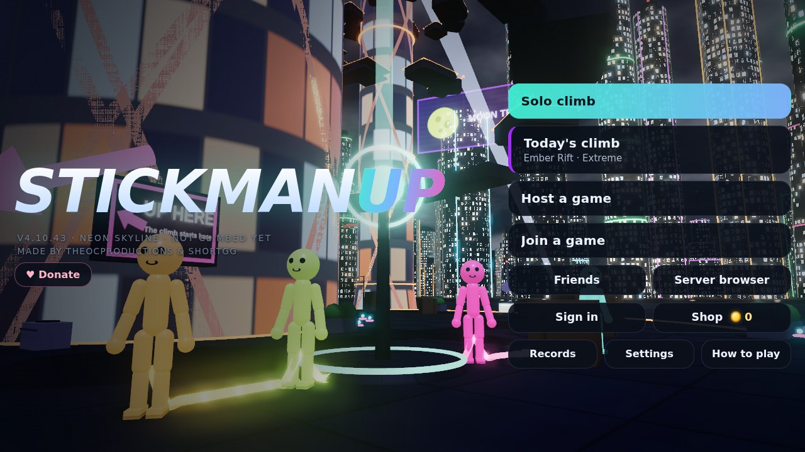
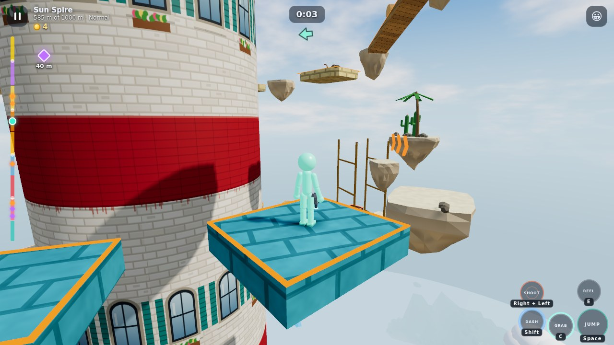
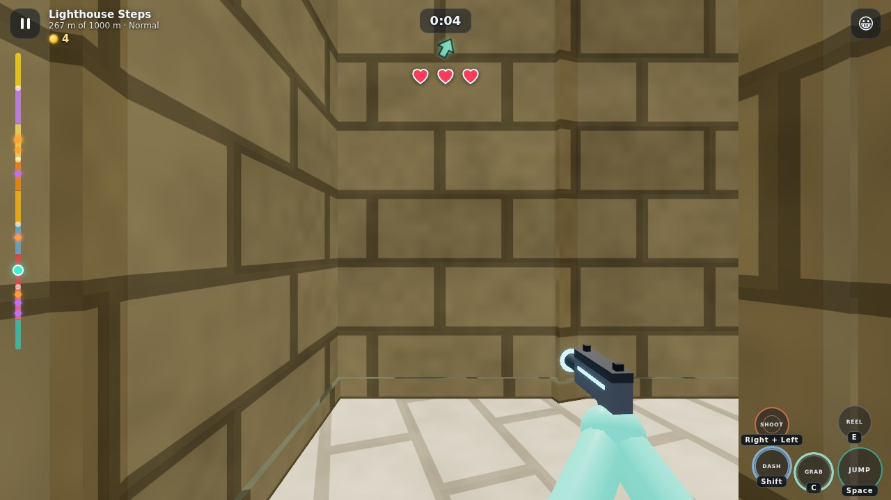
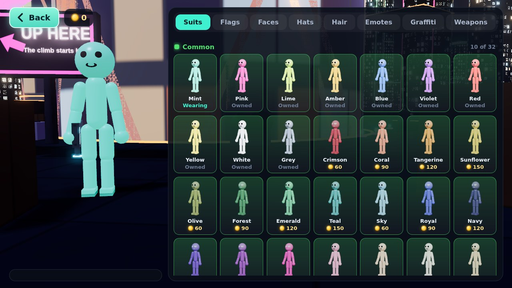
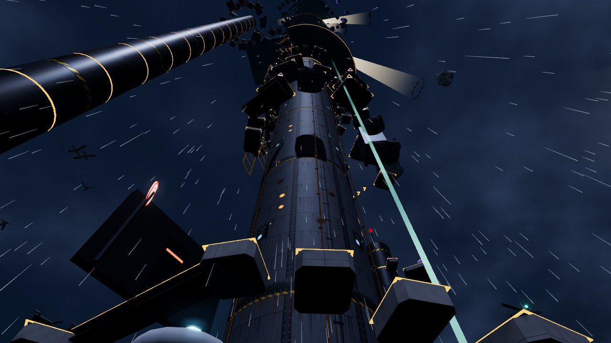
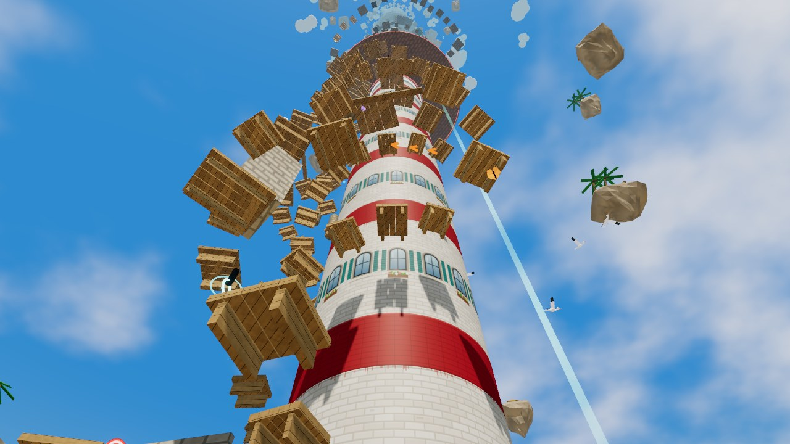
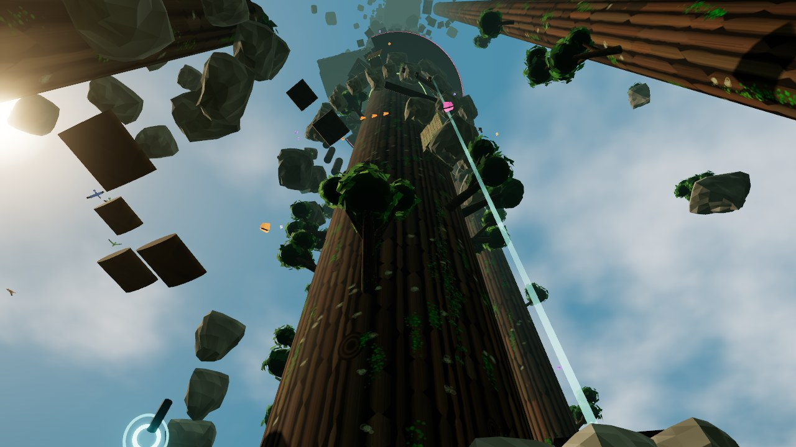
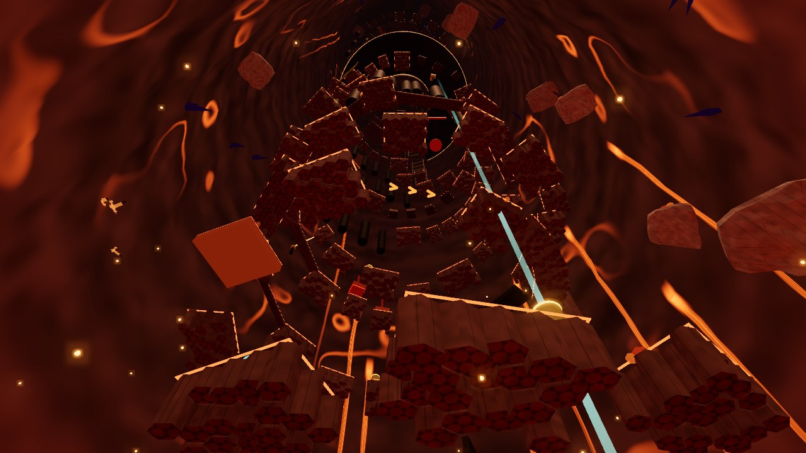
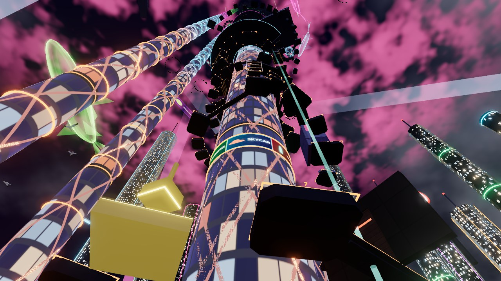
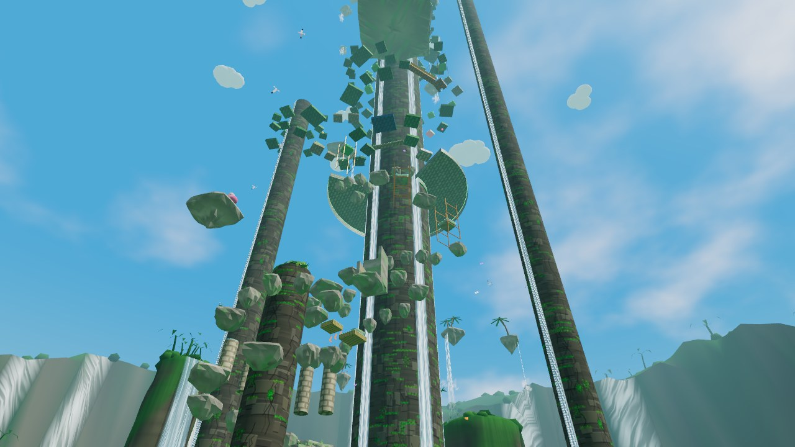

<div align="center">


<h1>StickManUp</h1>

<h3>Four stickmen. One glowing cord. 1000 metres straight up.</h3>

Climb together, fall together. If one of you slips, the whole team feels it.

<br>

<a href="https://github.com/TheOCP/stickmanup/releases/latest"></a>


<br><br>

<a href="https://github.com/TheOCP/stickmanup/releases/latest/download/StickManUp.apk"></a>
&nbsp;
<a href="https://github.com/TheOCP/stickmanup/releases/latest/download/StickManUp-Setup.exe"></a>
&nbsp;
<a href="https://theocp.github.io/stickmanup/"></a>

<br><br>



<sub>Android 8.0 or newer, about 3 MB, no root needed. Windows 64 bit, updates itself.<br>
The browser version runs on iPhone and iPad too: open it in Safari and choose Add to Home Screen.</sub>

<br><br>

<table>
<tr>
<td align="center" width="140"><h2>112</h2>maps</td>
<td align="center" width="140"><h2>70+</h2>obstacles per map</td>
<td align="center" width="140"><h2>172</h2>suits</td>
<td align="center" width="140"><h2>50</h2>weapons</td>
<td align="center" width="140"><h2>55</h2>emotes</td>
<td align="center" width="140"><h2>60</h2>graffiti</td>
</tr>
</table>

</div>

<br>

## The climb

Up to four friends are tied together by a glowing cord and climb a giant tower, from the dock all the way to the top
1000 m above. Run, jump, dash, wall jump, grab on and haul each other up. Every zone is harder than the one before:
smaller platforms, more obstacles, everything faster. And when one of you falls, the cord drags on everyone else.

Android, Windows and browser players all climb together in the same rooms.

<table>
<tr>
<td width="33%"></td>
<td width="33%"></td>
<td width="33%"></td>
</tr>
</table>

<br>

## Six worlds

<table>
<tr>
<td width="50%" valign="top"><h3>Storm Tower</h3>A weather station in a lightning storm at night. Lightning hunts you: when a ring in your colour lights up under you, raise your shield. Lasers, rods, fans and ice.</td>
<td width="50%" valign="top"><h3>Sunny Isles</h3>A white lighthouse over a turquoise sea. Hop between two lanes past arrow traps, swinging anchors and cannonballs from a pirate ship.</td>
</tr>
<tr>
<td width="50%" valign="top"><h3>Wild Forest</h3>Round a giant tree in a misty forest and out along its branches to smaller trees. Wolves on the ledges, bats in the air and a bee swarm on your heels.</td>
<td width="50%" valign="top"><h3>Magma Chimney</h3>Up the inside of a hollow volcano while the lava lake rises below you. Ride erupting vents, dodge falling boulders and hold on through the quakes.</td>
</tr>
<tr>
<td width="50%" valign="top"><h3>Neon Skyline</h3>The Nexus, the tallest tower of a neon city at night. Flying cars carry you out to floating pylons while giant koi holograms swim round the tower.</td>
<td width="50%" valign="top"><h3>Waterfall</h3>Zigzag up a mossy rock with waterfalls pouring down it. Run up water slides, dodge leaping fish and ride the fountains.</td>
</tr>
</table>

**And 100 more.** Every world comes back in a hundred more climbs, each with its own seed, colours, zone order and twists
like Frozen, Windy, Crumbling or Night. **Today's climb** is the same map for everyone, every day, and on holidays it turns
into Haunted Hollow, Frosty Peaks, Countdown Tower, Sweetheart Cliffs, Egg Hunt Grove or Midsummer Light.

<br>

## What's up there

<table>
<tr>
<td width="33%" valign="top"><h3>Maze gardens</h3>Closed mazes at the checkpoints, played in first person with your weapon in hand. A creature hunts you through the corridors, and the maze changes every time.</td>
<td width="33%" valign="top"><h3>Relic hunts</h3>Legendary suits and weapons wait at the end of hard parkour courses far out past the route. Every epic item hides in a secret spot of its own.</td>
<td width="33%" valign="top"><h3>Map events</h3>From 400 m up each map throws its own trouble at you: gusts, waves, laser strikes, cannonballs, quakes and bee swarms.</td>
</tr>
<tr>
<td width="33%" valign="top"><h3>Ghost racing</h3>Your best climb and the best climbs of your friends run beside you as see through climbers. A line at the top shows who is ahead.</td>
<td width="33%" valign="top"><h3>Traitor mode</h3>With three or more climbers, one of you is secretly sabotaging the team. Read the clues, call a vote and catch them before the top.</td>
<td width="33%" valign="top"><h3>Graffiti</h3>Spray pictures on the towers. Everyone in the room sees them at once, and whoever climbs there later finds them too.</td>
</tr>
<tr>
<td width="33%" valign="top"><h3>Friends</h3>Add friends by name or player ID, see where they are climbing, watch them live or jump straight into their room.</td>
<td width="33%" valign="top"><h3>Your look</h3>172 suits, 68 hats, 35 hairstyles, 85 faces and 50 weapons. Legendary suits move, glow and leave a trail behind you.</td>
<td width="33%" valign="top"><h3>Live soundtrack</h3>Original electro made live while you play, with its own style for every map, getting busier the higher you climb.</td>
</tr>
</table>

<br>

## Moves

<table>
<tr><td width="150"><b>JUMP</b></td><td>Tap for a hop, hold for full height</td></tr>
<tr><td><b>Wall jump</b></td><td>Jump at a wall and press JUMP as you touch it. Bounce between two walls to get up a shaft.</td></tr>
<tr><td><b>DASH</b></td><td>A quick burst where you point, in the air too, once until you land</td></tr>
<tr><td><b>GRAB</b></td><td>Hold to clamp onto anything you touch, even walls, for as long as your grip lasts</td></tr>
<tr><td><b>REEL</b></td><td>Pull the cord in. It turns into PULL to haul a friend up over the edge, and CLIMB when you are the one hanging.</td></tr>
<tr><td><b>Sling</b></td><td>Hold GRAB, then REEL, then let go of REEL to fling your partner upward</td></tr>
<tr><td><b>GRAPPLE</b></td><td>Zip up to a glowing hook and get thrown across the gap</td></tr>
<tr><td><b>SHOOT</b></td><td>Hold to aim, let go to fire. A hit paralyses creatures and jumpers. No auto aim.</td></tr>
<tr><td><b>SHIELD</b></td><td>Blocks lightning on Storm Tower</td></tr>
</table>

<details>
<summary><b>Keyboard, mouse and controller</b></summary>
<br>

**Keyboard and mouse:** WASD to move, Space to jump, Left Shift to dash, C to grab (Ctrl too in the apps), E to reel,
F to grapple, Q to shield, T for emotes. The mouse turns the camera, hold right click (or R) to aim and left click to
fire. Esc pauses. F11 or Alt+Enter goes fullscreen, and the frame rate goes up to 144 in Settings.

**Controller:** left stick moves, right stick looks, A jumps, B grabs, X grapples, Y dashes, RB reels, LB shields, hold
LT to aim and RT to fire. The buttons on screen switch to Xbox, PlayStation or Nintendo names as soon as you use one, and
the controller works in every menu too.

**Touch:** a floating stick on the left, drag on the right to look. Every button can be resized, moved anywhere or made
see through in Settings.

</details>

<br>

## Play together

<table>
<tr>
<td width="50%" valign="top"><h3>Game server</h3>Works on every network. Browse public rooms, or make your own: public or private, with or without a password. Coins and records count here.</td>
<td width="50%" valign="top"><h3>Online</h3>The host gets a five letter room code and friends type it in. The devices connect straight to each other.</td>
</tr>
</table>

* Up to four climbers, on Android, PC and browser in the same room
* Friends can join a climb that is already running
* Turn the cord off and everyone keeps their own checkpoint
* Turn friendly fire on and your shots throw your friends off the climb

<br>

## Four difficulties

<table>
<tr>
<td width="25%" valign="top"><h3>Easy</h3>A checkpoint in every zone, a long cord and only the gentler obstacles.</td>
<td width="25%" valign="top"><h3>Normal</h3>Four checkpoints on the whole climb and most obstacles.</td>
<td width="25%" valign="top"><h3>Hardcore</h3>No checkpoints, a short cord and every obstacle on and faster. Fall to the bottom and the team starts over.</td>
<td width="25%" valign="top"><h3>Insane</h3>Faster still, with a very short cord and barely any grip.</td>
</tr>
</table>

Or set your own rules: checkpoints, obstacles and cord length.

<br>

## Fair play

Coins and everything you own are kept on the game server, so nobody can lose them or make them up. Every climb that earns
coins is played again on the server with the same physics, so speed hacks, flying, teleporting and edited saves earn
nothing. Sign in with Discord, Steam or Google, or play as a guest. You can delete your account and everything on the
server at any time.

<br>

## Smooth everywhere

On Android the world is drawn by the game's own OpenGL ES 3.0 renderer instead of WebGL. Auto graphics watches how long
every frame really takes and trades resolution, edge smoothing and view distance to stay smooth, then gives them back when
there is room. 30, 60 or 120 fps on phones, up to 144 on a PC.

<br>

## For developers

<details>
<summary><b>Build from source</b></summary>
<br>

No Gradle or Android Studio needed. On Debian or Ubuntu (arm64 works, also inside Termux proot) install a JDK, aapt,
apksigner, zipalign, the Android platform 23 jar and dalvik exchange, then run:

```sh
./build.sh
```

That makes `build/StickManUp.apk`. On first run `build.sh` creates a local signing key (`stickmanup.jks`). The key is not
in this repo. Keep your own copy, because Android only installs updates signed with the same key.

To play or debug in a desktop browser, serve the `assets` folder with any static web server.

</details>

<details>
<summary><b>How it is built</b></summary>
<br>

* `assets/js/`: the whole game in plain JavaScript modules on top of [three.js](https://threejs.org)
  * `level.js` builds the same maps on every device from fixed seeds, checking clearance as it goes
  * `physics.js`, `player.js`, `chain.js`: collision, movement, abilities and the cord
  * `storm.js`: every hazard and creature, timed from shared game time so every device agrees
  * `net.js`, `game.js`: multiplayer through the host, with each device running its own climber
  * `cloud.js`, `replay.js`, `detmath.js`: accounts, coins, and the climb records the server plays again
  * `render.js`, `worldview.js`, `cityview.js`, `backdrop.js`, `scenery.js`: sky, weather, the worlds and their far lands
  * `stickman.js`, `viewgun.js`: the climbers with their emotes, and your arms and weapon in first person
  * `audio.js`: every sound made live, the music too
  * `mirror.js`: streams the scene to the native renderer
* `src/`: the Android app, a full screen WebView with the native OpenGL ES renderer (`src/io/stickmanup/gl/`) and the updater
* `desktop/`: the Windows app
* `server/`: the game server, accounts, anticheat and Discord bot, with an installer that does everything.
  See [server/README.md](server/README.md) to run your own.
* `dev/`: tests for the levels, physics, shortcuts and courses, and scripts that drive the game in headless Chromium

</details>

<br>

<div align="center">


<sub>Made by TheOCProductions and ShortGG<br>Built with three.js and PeerJS, both MIT licensed</sub>

</div>
