# StickManUp

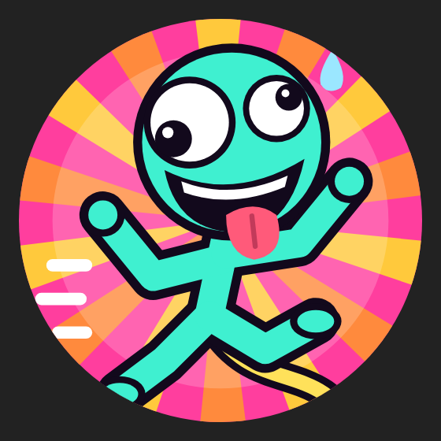

A co op climbing game for Android. Up to four stickmen are tied together by a glowing cord and climb one of six
giant maps. If one falls, everyone feels it.

**[Download the latest APK](../../releases/latest)** · Android 8.0 or newer · no root needed · about 600 KB

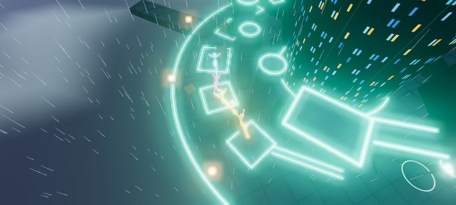

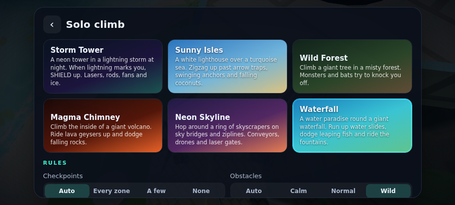
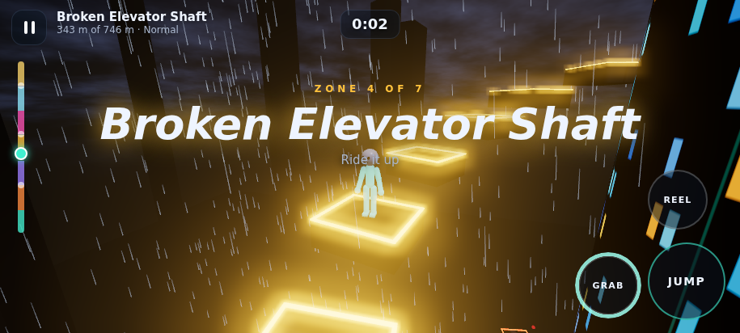
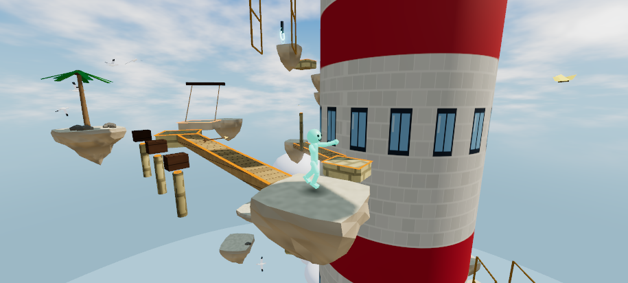
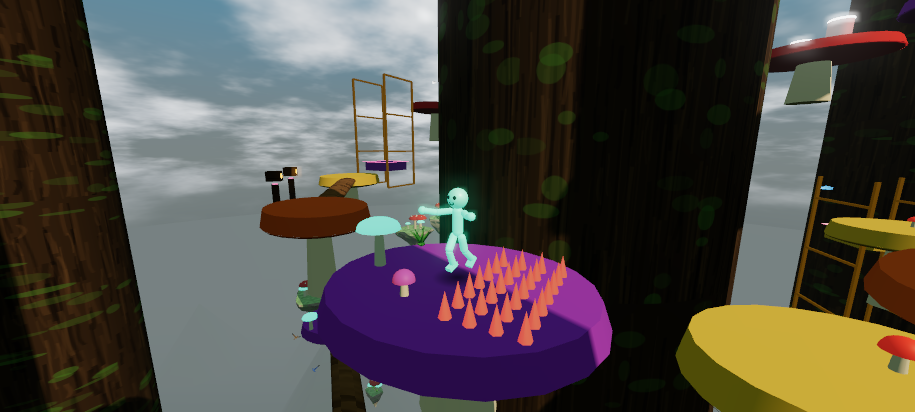
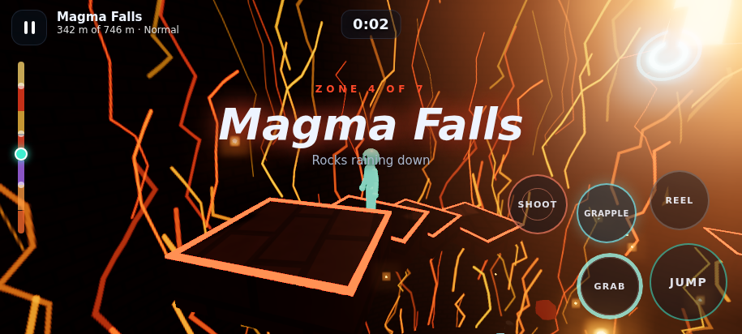
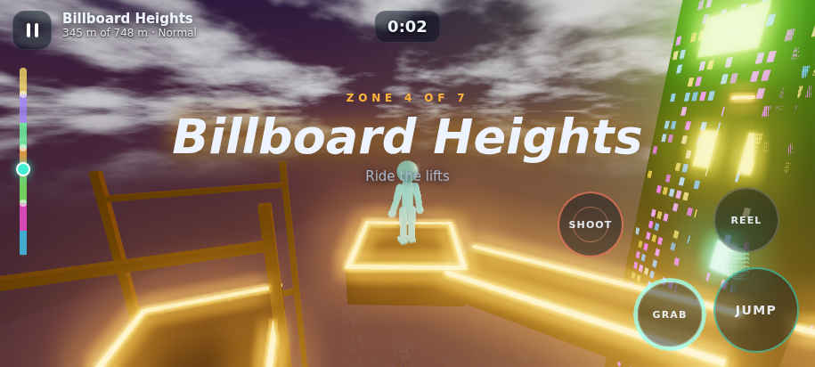
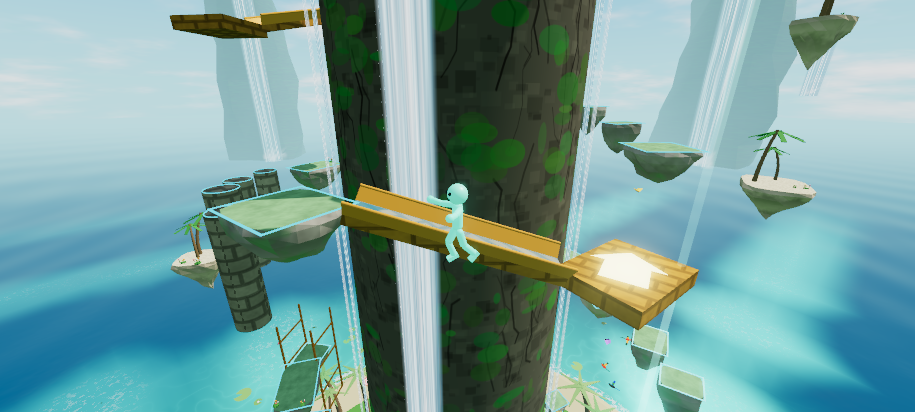
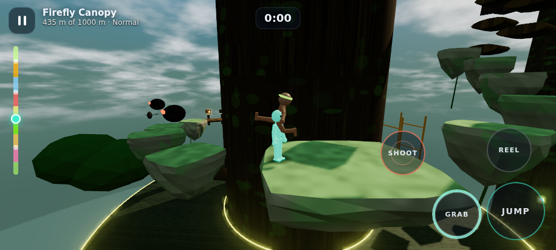
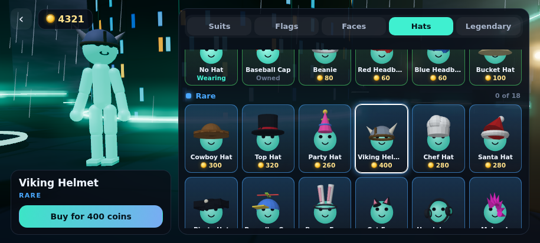
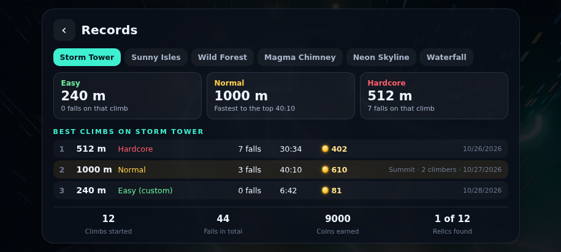

## Six maps

Each map is a 1000 m climb in nine zones, and each one climbs its own way. The higher you get, the harder it gets:
smaller platforms, more obstacles, and everything moves faster.

* **Storm Tower**: round and round a neon tower in a lightning storm at night. Lightning hunts you: when a ring in
  your colour appears under you, tap **SHIELD**. Lightning rods, spinning laser bars, laser gates, fans and ice.
* **Sunny Isles**: back and forth across a white lighthouse in two lanes, hopping over at each turn. Arrow traps
  and swinging platforms.
* **Wild Forest**: round a giant tree, with branch walks out to smaller trees that you climb around before coming
  back. Monsters, bats and arrow traps.
* **Magma Chimney**: up the inside of a hollow volcano above a lava lake. Stand on a vent when it erupts and it
  launches you to the ledge above; stand next to it and it shoves you off. Shadows show where boulders will land.
* **Neon Skyline**: a ring of skyscrapers round a central spire at sunset. Climb round one tower, cross to the next
  over a sky bridge or by zipline, and work your way round the ring to the top. Conveyor belts, drones and laser
  gates.
* **Waterfall**: a water paradise. Climb a mossy rock with waterfalls pouring down it into a clear lagoon, past
  palms, lily pads, fountains and far off cliffs with their own falls. Fight up water slides while inner tubes roll
  down at you, fly off launch slides onto higher ledges, dodge
  fish leaping across the bridges, ride fountains up and keep your footing on lazy rivers.

Every map also has grapple hooks over wide gaps and doors that open when you shoot their target. The route
does not just circle: it now and then rides a lift up and turns back the other way, or detours out to floating
platforms away from the tower before heading back in.

Two kinds of section need the new moves. Gaps too wide to jump have glowing arrows in the air: jump, then DASH across.
Shafts between two high walls have orange rungs up the walls: bounce up with wall jumps and out over the lower wall.

**Obstacles**

Each map has 36 obstacles of its own, built to fit it. The higher zones bring in the harder ones, and from about
650 m up come six endgame obstacles: twin pendulums over a long bridge, spike grids that pop up two squares at a
time, things rolling along narrow bridges, rows of presses slamming in turn, crossfire jets with one safe spot,
and turntables with bars spinning over them.

From about halfway up come ten more, the hardest of all: twin rollers to run between, three swings in a row, spikes
rising in a wave, rows of presses over gaps, ladders of jets, stones that flicker away under you, chains of
trapdoors, twin sweeps, a dash gap with something swinging through it and a wall jump shaft with jets firing across.
They have their own look on each map, like Twin saw rails and Arc shaft on Storm Tower, or Thorn wave and Spore shaft
in Wild Forest.

* **Storm Tower**: turbine sweeps, Tesla pendulums, piston rams, hydraulic presses, arc spikes, plasma jets, phase
  platforms, a saw track, a wrecking ball, grease pits and more
* **Sunny Isles**: coconut drops, rolling beach balls, anchor pendulums, cannon shots, wave walls, a carousel deck,
  wet sand, sinking planks, blowholes, buoy bumpers and more
* **Wild Forest**: rolling logs, spiked log swings, thorn patches, spore bursts, mushroom bumpers, mud pits, root
  trapdoors, a charging boar, beehive swings, bee swarms and more
* **Magma Chimney**: fire bars, flame jets, obsidian spikes, molten pendulums, stone presses, tar pits, vent
  trapdoors, lava surges, a meteor shower, fire bats and more
* **Neon Skyline**: security sweeps, a crane wrecking ball, runaway carts, trash compactors, steam pipes, hologram
  platforms, a spinning helipad, airbag bumpers, saw drones and more
* **Waterfall**: water slides, leaping fish, fountain lifts, lazy rivers, tipping buckets, spinning sprinklers,
  swinging buoys, water cannons, sinking lily pads, a whirlpool deck, swim ring bumpers, flying fish and more

Most of them shake, flicker or glow just before they strike.

**Jumpers**

Every map has angry dummies guarding ledges from about 500 m up, and on Hardcore and Insane already from 50 m, in the map's own
style: storm dummies, beach bullies, wild jumpers, ash brutes, street punks and splash bullies. Come close and they run
at you and jump kick you off the ledge. Jump past them, or SHOOT to stun them for a few seconds.

**Coins, shop and records**

Coins hang all along every route. Each is worth 1 on Easy, 2 on Normal, 3 on Hardcore and 4 on Insane, and the top pays
a bonus of 100, 250, 500 or 800. A coin you took stays gone after a fall.

The first time you win a difficulty you also get a big one time bonus: 2000 on Easy, 4000 on Normal, 10000 on Hardcore
and 20000 on Insane. Climbs with custom rules don't count for it.

Spend them in the shop:

* **Common (green):** colours, simple faces and caps
* **Rare (blue):** 41 country flags with a matching cape, patterns, funny faces and hats
* **Epic (purple):** full costumes like Ninja, Knight, Astronaut, Skeleton and Solid Gold, with their own face and hat
* **Legendary (orange):** living suits that move and leave a trail. Coins can't buy them. They only come from Hardcore
  and Insane: a few are earned by what you do up there, the rest are hidden. Those who know, know.
* **Emotes:** a tab of their own with 23 moves, like the wave, the floss, flips, a cartwheel, the running man, the worm,
  the windmill and a headspin. Wave, Clap, Thumbs up and Backflip are free, the rest cost 60 to 1000 coins.

Your other climbers see what you wear. The records keep your best climbs on every map: how high you got, on which
difficulty, how many falls, how long and how many coins.

**Every map looks different**

Platforms change with the map and the zone: tread plate and hex tiles, wooden docks, floating sandstone islands,
clouds, giant mushroom caps, grassy rocks, basalt columns, obsidian, concrete roofs, lily pads, bamboo rafts, coral
and marble. Floating islands (ledges in the volcano, balcony gardens on the skyscrapers) carry trees and props that
suit the zone: palms, pines, oaks, birches, blossom, bamboo, dead trees, glowing trees, cactus, coral, crystals,
antennas and water tanks. Flocks of birds, butterflies, crabs, dolphins, deer, frogs, turtles and lizards live around
the climb. The graphics preset scales all of this: Low drops the small stuff for cheaper phones.

**Difficulties**

* **Easy**: a checkpoint in every zone, a long cord, a calmer storm and only the gentler obstacles, running slower
* **Normal**: four checkpoints on the whole climb and most obstacles
* **Hardcore**: no checkpoints and a shorter cord. Every obstacle is on and faster. Fall all the way down and the
  team starts over.
* **Insane**: everything Hardcore has, faster still. A very short cord, barely any grip, and almost no time left to
  jump once you have run off a ledge.

**Rules**: when starting a climb (solo, or the host in the lobby) you can also set the checkpoints (every zone, a
few, none), the obstacles (calm, normal, wild) and the cord length yourself. Auto follows the difficulty. Climbs
with custom rules keep their own best times.

The climb saves itself. Solo players can continue from the title screen, and a multiplayer host can continue the
saved climb from the lobby.

## Moves

* **Left side of the screen**: a floating stick to move
* **Right side of the screen**: drag to look around
* **JUMP**: tap for a hop, hold for full height
* **Wall jump**: in the air, jump at a wall and press JUMP as you touch it to kick off, up and away. You can't kick off
  the same wall twice in a row, so bounce between two walls.
* **DASH**: a quick burst where the stick points, or where you are looking if you aren't touching it. It works in the
  air too, once until you land.
* **GRAB** (hold): clamp onto anything you touch, even walls. Grip drains faster on walls.
* **REEL** (hold): pull the cord in. It turns into **PULL** when your partner hangs below you (it hauls them up and
  over the edge) and **CLIMB** when you're the one hanging.
* **GRAB, then REEL, then let go of REEL**: sling your partner upward
* **GRAPPLE**: shows up near a hook. You zip up and get thrown across.
* **SHOOT**: hold to aim over your shoulder, drag the crosshair, let go to fire. No auto aim.
* **SHIELD** (Storm Tower): blocks lightning and hits for a second
* **Emotes**: the smiley at the top right opens the menu during a climb. Everyone climbing with you sees them. Flips
  start with a small jump, and moving ends a pose.

Keyboard: WASD, Space, Shift, E, F grapple, R hold to aim, Q shield, C or left Ctrl dash, T emotes.

Controller: left stick moves, right stick looks, A jump, B grab, X grapple, Y or pressing in the left stick dash, LT hold
to aim, RT fire (aimed or from the hip), RB reel, LB shield, direction pad down emotes.

A controller works in every menu as well: move with the direction pad or left stick, A selects, B goes back, LB and RB
switch tabs, and text boxes open a letter board. Select opens the pause menu on Back to checkpoint. Settings has a dead
zone for each stick against stick drift, with a live view of where the sticks really are.

Settings let you resize the buttons, change their opacity, put them on the left, or drag each one wherever you
like. The FPS counter can go anywhere on the screen too. Tips show up once as see through cards; after that, tap the
small **!** markers to read them again.

## Multiplayer

Up to 4 climbers. Everyone needs the same StickManUp version. The host picks the map. Tied together, the team
shares its checkpoints and falls back together. With the cord turned off in the lobby, nobody is tied together and
everyone keeps their own checkpoint: a fall only sends you back to yours.

* **Game server**: works on every network, because every phone only connects out to the server. Open the **server
  browser** to see public rooms, or create a room: public or private, with or without a password. A private room only
  shows to people who have its code. The host's phone still runs the climb, so the room ends if the host leaves.
  Run your own: see [server/README.md](server/README.md).
* **Online**: the host gets a 5 letter room code and friends type it in. The phones connect directly over
  WebRTC; the free [PeerJS](https://peerjs.com) server only introduces them. Some networks (often mobile data)
  don't allow that direct connection, so use the game server then.

Friends can join a climb that is already running.

## Friends

Every player has a player ID, shown on the Friends screen with a button to share it. Search by in game name or ID and
send a request. Once it is accepted you can see which friends are online and, while they climb, the map, difficulty,
height, time, falls and who they climb with. Tap Watch to follow their climb live (it works for solo climbs too), or Join
if their room has a free spot. Anyone who would rather not be watched can turn that off on the same screen, and a climber is
told who is watching. Both people need the game server.

Friends can join a climb that is already running.

## Accounts

Coins and what you own are kept on the game server, so nobody can lose them or make them up. On first start you can accept the
terms and play as a guest, or sign in with Discord, Steam or Google. A guest's coins are on the server too, but only that
phone can reach them. Signing in moves them to an account that works on any phone. Or play without coins, with nothing
sent anywhere. You can delete your account and everything on the server at any time.

Coins only count alone or in a room on the game server. Offline and in Online games you climb the same
but earn nothing, because nothing can check those.

Every climb that earns coins is played again on the server with the same physics, so a speed hack, a higher jump, flying, teleporting
or an edited save all show up. Coins from older versions that were kept on the phone are gone: only the server counts now.

## Smooth on any phone

On Android the 3D world is drawn by the app's own OpenGL ES 3.0 renderer, not by WebGL in the WebView. The game
sends only what changed each frame. Clouds, water and surface detail read from one noise texture baked at startup
instead of being worked out for every pixel, and shaders, models and textures are prepared before they first come
into view. Every picture is handed to the display with the exact screen refresh it belongs to, and the climber is
drawn between physics steps, so movement stays even.

Auto graphics measures how long the GPU really needs for each frame. When a phone gets near its limit it lowers the
resolution, then the edge smoothing, then switches to simple lighting, and it takes those back when there is room
again. The scene is scaled inside a fixed size picture, so the screen never resizes during play.

Graphics settings: resolution, sharpness, smooth edges (anti aliasing), glow, simple lighting, 30, 60 or 120 fps, and
auto graphics on or off.

The soundtrack is generated live: an original electro and techno track with its own style for every map, building
in sections and getting busier the higher you climb.

## Build from source

No Gradle or Android Studio needed. On Debian or Ubuntu (arm64 works, also inside Termux proot) install a JDK,
aapt, apksigner, zipalign, the Android platform 23 jar and dalvik exchange, then run:

```sh
./build.sh
```

That makes `build/StickManUp.apk`. On first run `build.sh` creates a local signing key (`stickmanup.jks`). The key
is not in this repo. Keep your own copy, because Android only installs updates signed with the same key.

To play or debug in a desktop browser, serve the `assets` folder with any static web server.

## How it works

* `assets/js/`: the whole game in plain JavaScript modules on top of [three.js](https://threejs.org)
  * `level.js` generates the identical maps on every phone from fixed seeds, checking clearance as it builds
  * `physics.js`, `player.js`, `chain.js`: collision, movement, abilities and the cord
  * `storm.js`: lightning, fans, gusts, lasers, arrows, geysers, boulders, monsters, bats and drones, all timed
    from shared game time so every phone agrees
  * `net.js`, `game.js`: host relayed multiplayer; each phone simulates its own climber and applies its share of
    the cord pull, so the game stays responsive over a laggy connection
  * `cloud.js`: the game server, signing in, coins and keeping progress on your account
  * `replay.js`: writes down each climb as it is played, for the server to play again
  * `detmath.js`: maths that comes out exactly the same on a phone and on a server
  * `render.js`, `worldview.js`, `stickman.js`: sky, sun, sea, weather, the maps and the animated stickmen with their emotes
  * `scenery.js`, `pattern.js`: platform shapes and surfaces, islands and plants per zone, GPU animated animals,
    waterfalls and spray
  * `mirror.js` streams the scene to the native renderer
* `src/`: a small Java activity that runs the game in a full screen WebView, the native OpenGL ES renderer
  (`src/io/stickmanup/gl/`), and WiFi, internet direct (UPnP and STUN) and Bluetooth sockets for the game
* `server/`: the game server, accounts and database, with an installer that does everything. See
  [server/README.md](server/README.md)
* `dev/`: node tests for the levels, physics and networked cord, Playwright scripts that drive the game in
  headless Chromium, a desktop harness that replays a recorded frame through the native renderer, the icon
  generator, and `sync_pattern.py`, which copies the surface patterns into the native renderer

Uses three.js and PeerJS, both MIT licensed.
